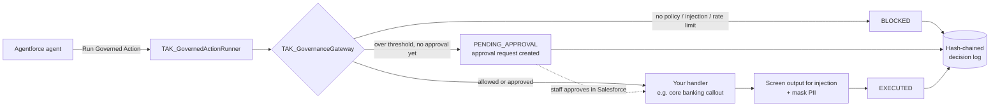

# Trusted Agent Kit

**Open-source governance for AI agents in banking, built natively on Salesforce.**

Banks want to put AI agents (Agentforce or any LLM that calls Salesforce actions) in front of customers and staff. Their risk, compliance and audit teams then ask the same questions every time:

- *What stops the agent from doing something it shouldn't, even if a customer tries to trick it?*
- *Which actions need a human to approve them, and can that approval be reused or tampered with?*
- *Is customer PII sent to the model or written to logs?*
- *Can you prove, a year from now, exactly what the agent did, and that nobody edited the record?*

Trusted Agent Kit answers those questions with a small, deployable Salesforce package. Every agent action passes through one governed entry point that enforces policy, screens for prompt injection, routes risky requests to a human, masks PII, and writes a tamper-evident audit trail.

## What it does

| Control | How it works |
|---|---|
| **Fail-closed policy enforcement** | Each action has an `Agent Policy` (custom metadata): risk tier, handler class, approval rules, rate limit. Actions with no active policy are blocked. |
| **Prompt-injection screening** | 14 weighted rules tuned for banking social engineering (instruction override, prompt extraction, role hijack, "skip the approval", secrecy requests, hidden Unicode, role markers). Scans the customer's message **and** every string in the action payload. |
| **Indirect injection defence** | Results returned by your systems (case notes, memos) are screened too. If they contain instructions aimed at the agent, they are withheld from the model and flagged. |
| **Human approval gates** | Approvals are bound to a SHA-256 hash of the exact payload, single-use, time-limited, and require a custom permission. Requesters can never approve their own requests (segregation of duties). |
| **PII masking** | SSNs, Luhn-validated card numbers, ABA-validated routing numbers, account numbers, emails and phone numbers are masked in logs, approval screens, and (per policy) in what the model sees. |
| **Tamper-evident audit log** | Every decision is appended to a hash chain. Records are append-only (trigger-enforced). A verifier detects edited, deleted or truncated records and reports exactly where. |
| **Rate limiting** | Per user, per action, per hour. |
| **Callout-safe** | No DML happens until your handler returns, so handlers can call core banking APIs. |

## How it works



See [docs/ARCHITECTURE.md](docs/ARCHITECTURE.md) for the full design and threat model.

## Quick start

Prerequisites: [Salesforce CLI](https://developer.salesforce.com/tools/salesforcecli) and a Dev Hub (or any sandbox / Developer Edition org).

```bash
git clone https://github.com/<your-username>/trusted-agent-kit.git
cd trusted-agent-kit

# Scratch org
sf org create scratch --definition-file config/project-scratch-def.json --alias tak --duration-days 7
sf project deploy start --target-org tak

# Permissions
sf org assign permset --name TAK_Governance_Admin --target-org tak
sf org assign permset --name TAK_Agent_Runtime --target-org tak

# Tests
sf apex run test --target-org tak --test-level RunLocalTests --code-coverage --result-format human --wait 20
```

Try it from Anonymous Apex:

```apex
TAK_GovernedActionRunner.Response r = TAK_GovernedActionRunner.run(
    'Demo Agent', 'Initiate_Transfer',
    '{"fromAccount":"11112222","toAccount":"33334444","amount":25000}',
    'Please wire 25k for my house closing', 'demo-session-1');
System.debug(r.status + ' | ' + r.message);
// PENDING_APPROVAL | This action needs approval from a bank employee ...
```

Then open the **Agent Approval Requests** and **Agent Decision Logs** objects to see the request and the log entry.

Connecting it to an Agentforce agent: [docs/AGENTFORCE_SETUP.md](docs/AGENTFORCE_SETUP.md).

**Live demo:** deploy the optional `demo/` folder and follow [docs/DEMO_GUIDE.md](docs/DEMO_GUIDE.md): 13 one-line scenes, from a blocked prompt injection to catching an insider who edits the audit log.

## Adding your own governed action

1. Implement the handler:

```apex
public with sharing class OpenDisputeAction implements TAK_GovernedAction {
    public Map<String, Object> execute(Map<String, Object> payload) {
        // Call your dispute system here. Governance has already run.
        return new Map<String, Object>{ 'disputeId' => 'D-1042', 'status' => 'OPEN' };
    }
}
```

2. Create an **Agent Policy** record (Setup → Custom Metadata Types → Agent Policy → Manage Records):

| Field | Example | Meaning |
|---|---|---|
| Action Name | `Open_Dispute` | Name the agent passes |
| Handler Class | `OpenDisputeAction` | Your class |
| Risk Tier | `Medium` | Shown to approvers and in reports |
| Requires Approval | ☐ / ☑ | Route to a human first |
| Approval Amount Threshold | `500` | Approve only at or above this (blank = always) |
| Amount Field | `amount` | Payload key with the amount |
| Injection Threshold | `50` | Block at this score (lower = stricter) |
| Max Calls Per Hour | `10` | Per user |
| Redact Output | ☑ | Mask PII before the model sees results |
| Approval Expiry Minutes | `60` | Decision deadline, then execution window |
| Approver Queue | `Dispute_Approvers` | Optional queue that owns requests |

3. Expose it to the agent, either through the generic **Run Governed Action** or a typed wrapper like `TAK_InitiateTransferAgentAction` (recommended: named inputs make the model's tool calls more accurate).

## Testing without an org

The detection rules can be replayed outside Salesforce. The harness extracts the exact regex strings from the Apex source and runs them through Java's regex engine (the engine Apex uses):

```bash
python3 tools/rule-harness/run.py
```

It runs the adversarial suite in `force-app/main/default/staticresources/TAK_AdversarialPrompts.json` (24 attacks that must be blocked, 14 ordinary customer messages that must not be) plus PII redaction cases. The same suite runs inside Salesforce as `TAK_AdversarialSuiteTest`. **Contributions of new attack patterns and false-positive cases are especially welcome.**

## Repository layout

```
force-app/main/default/
  classes/            Apex engine, invocable actions, example handlers, tests
  objects/            Decision Log, Approval Request, Audit Chain, Agent Policy (metadata type)
  customMetadata/     Sample policies: balance inquiry, transfer, contact-info change
  permissionsets/     Agent Runtime, Approver, Governance Admin
  staticresources/    Adversarial prompt suite
demo/                 Optional demo pack: scene runner, poisoned case-note handler
docs/                 Architecture, threat model, Agentforce setup, demo guide, model-risk template
scripts/              Demo scene scripts, reset and guard toggles
tools/rule-harness/   Offline rule tests
```

## Known limitations

Rule-based screening is a first line of defence, not a guarantee. It does not catch paraphrased attacks it has no rule for, non-English text, or heavily encoded payloads. Use it alongside Salesforce's own trust layer, least-privilege agent users, and human approval for anything that moves money. The full list is in [docs/MODEL_RISK_TEMPLATE.md](docs/MODEL_RISK_TEMPLATE.md#6-limitations-and-compensating-controls).

## Roadmap

- Lightning approval console with side-by-side payload diff
- Configurable rules in custom metadata (no deploy needed to add a pattern)
- Optional second-opinion classifier via an LLM call for borderline scores
- Shield Platform Encryption guidance and Event Monitoring integration
- Additional locales (Spanish-language attack patterns)

## Contributing

See [CONTRIBUTING.md](CONTRIBUTING.md). Please never include real customer data in issues, tests or examples.

## License

MIT. See [LICENSE](LICENSE).

*Not affiliated with or endorsed by Salesforce. Agentforce and Salesforce are trademarks of Salesforce, Inc.*
