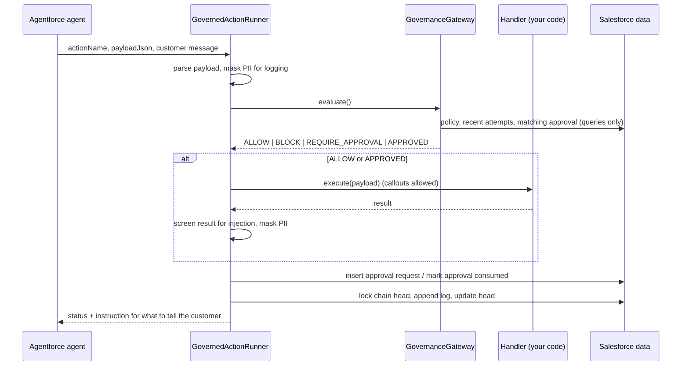

# Architecture and threat model

## Design principles

1. **One door.** The agent is given governed actions only. There is no path from the model to a bank operation that skips the runner.
2. **Fail closed.** No policy, an inactive policy, an unreadable amount, a missing handler: each results in a block or an approval request, never a silent pass.
3. **Deterministic controls first.** Policy, approval and audit logic is plain Apex that a validator can read and test. Nothing in the control path depends on a model's judgment.
4. **Evidence by default.** Every decision, including blocks, produces an immutable log record that an examiner can verify independently.
5. **Least data.** PII is masked before it is stored and, per policy, before the model sees results.

## Components

| Component | Type | Responsibility |
|---|---|---|
| `TAK_GovernedActionRunner` | Apex | Entry point. Orchestrates evaluation, execution, output screening, and the final DML. |
| `TAK_GovernanceGateway` | Apex | Policy decision point. Read-only: policy lookup, injection score, rate limit, approval match. |
| `TAK_PolicyService` | Apex | Loads `TAK_Agent_Policy__mdt`. |
| `TAK_InjectionDetector` | Apex | Weighted rule scoring with normalisation and hidden-character detection. |
| `TAK_PIIRedactor` | Apex | Ordered detectors with Luhn and ABA validation. |
| `TAK_ApprovalService` | Apex | Creates, matches, decides and consumes approval requests. |
| `TAK_AuditLogger` | Apex | Appends hash-chained log records under a row lock. |
| `TAK_AuditChainVerifier` / `TAK_AuditChainVerifyBatch` | Apex | Recomputes the chain; schedulable nightly. |
| `TAK_DecisionLogTrigger` | Trigger | Rejects updates and deletes on the log. |
| `TAK_RunGovernedActionInvocable` | Invocable | Generic agent action. |
| `TAK_InitiateTransferAgentAction` | Invocable | Typed example agent action. |
| `TAK_DecideApprovalInvocable` | Invocable | Approver action for Screen Flows. |
| `TAK_Agent_Decision_Log__c` | Object | Append-only audit records. |
| `TAK_Approval_Gate__c` | Object | Approval requests (field history on status and approver). |
| `TAK_Audit_Chain__c` | Object | Chain head: last hash and sequence. |

## Request lifecycle

## Approval binding

An approval request stores `SHA-256(lower(actionName) + "\n" + canonicalJson(payload))`. Canonical JSON sorts keys and normalises numbers, so `{"amount":25000,"to":"X"}` and `{"to":"X","amount":25000.00}` match, but any change to the payee or amount does not. To execute, the agent resubmits the request; the gateway looks for an **Approved, unexpired** request with the same hash **raised by the same user**, executes, and marks it **Consumed**. This prevents:

- approving $2,500 and executing $25,000 (payload mismatch)
- replaying one approval for repeated transfers (single use)
- approving today and executing next week (execution window)
- an employee approving a request raised under their own user (segregation of duties)

No raw payload is stored on the approval request; approvers see a PII-masked copy.

## Audit hash chain

Each record's hash covers its sequence number, the previous record's hash, the event time (to the second, GMT) and every content field. Fields are length-prefixed before hashing so boundaries cannot be shifted. Writers lock the single chain-head row (`SELECT ... FOR UPDATE`), so concurrent sessions are serialised.

The verifier reports the first of:

| Finding | Cause |
|---|---|
| `HASH_MISMATCH` | A field was changed after the record was written |
| `BROKEN_LINK` | A record's Previous Hash was rewritten |
| `SEQUENCE_GAP` | A record was deleted from the middle |
| `TAIL_MISSING` / `HEAD_MISMATCH` | The newest records were deleted or the head was altered |

The trigger blocks edits and deletes through normal channels. The chain makes tampering *evident* even by someone able to bypass the trigger (for example via a deployment). For stronger guarantees, periodically export the chain head hash to an external write-once store (see the model-risk template).

## Threat model

Mapped to the [OWASP Top 10 for LLM Applications (2025)](https://genai.owasp.org/llm-top-10/).

| Threat | OWASP | Mitigation in this kit | Residual risk / complement with |
|---|---|---|---|
| Customer tells the agent to ignore its rules | LLM01 Prompt Injection | Message and payload screened; block at threshold; logged with reasons | Paraphrased or non-English attacks; use human approval for money movement |
| Malicious text in a case note or memo steers the agent | LLM01 (indirect) | Handler output screened; flagged content withheld from the model | Same as above |
| Agent leaks PII to the model or logs | LLM02 Sensitive Information Disclosure | PII masked in logs, approval screens and (per policy) results | Free-text PII without recognisable patterns (names, addresses) |
| Agent performs a high-impact action on its own | LLM06 Excessive Agency | Fail-closed policies; approval gates bound to payload; rate limits; one governed entry point | Policy misconfiguration; review policies in change control |
| Customer extracts the system prompt | LLM07 System Prompt Leakage | Extraction phrasing screened before any action runs | Conversation-level leakage is outside this kit; rely on the platform's trust layer |
| Agent is driven into excessive calls | LLM10 Unbounded Consumption | Per-user, per-action hourly limits | Platform-level limits still apply |
| Insider edits or deletes evidence | (Audit integrity) | Append-only trigger; hash chain; nightly verification | Privileged deployment can disable the trigger; anchor head hash externally |
| Employee approves their own request | (Segregation of duties) | Requester can never decide; custom permission required | Collusion between two users |

## Security notes

- Logging, chain and approval classes run `without sharing` because audit infrastructure must work regardless of who the agent runs as. They return no data to callers beyond status.
- Approver authorisation is enforced in code by the `TAK_Approve_Agent_Actions` custom permission, not by record sharing.
- Invocable entry points run `with sharing`.
- Give the agent user only the `TAK_Agent_Runtime` permission set plus whatever your handlers need. Do not grant it the approver permission.
